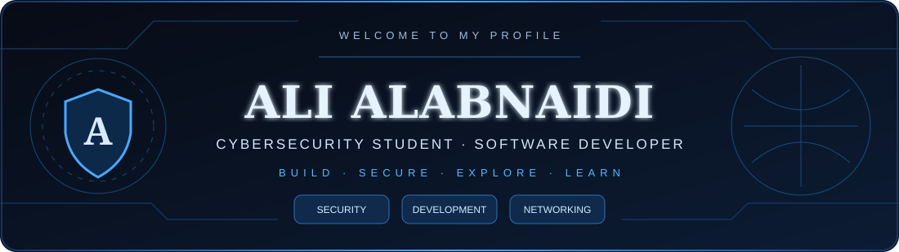
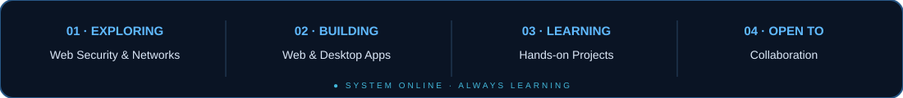
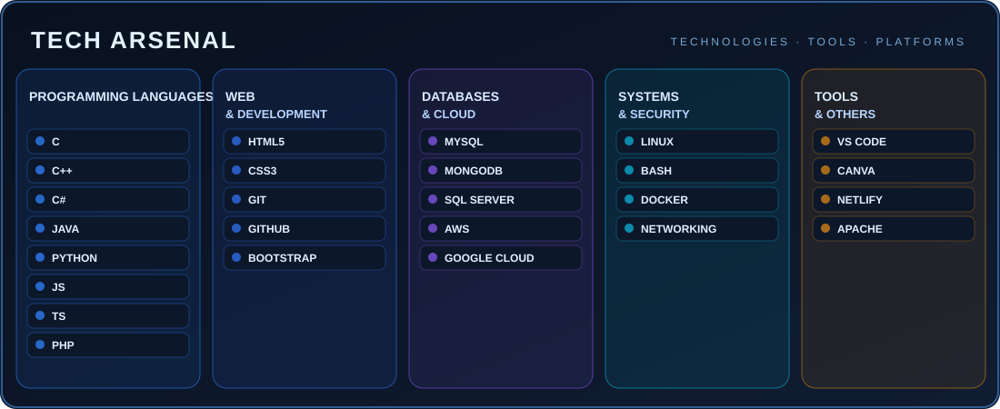

## 𝐀𝐁𝐎𝐔𝐓 𝐌𝐄

**I'M A CYBERSECURITY STUDENT AND SOFTWARE DEVELOPER** WHO ENJOYS UNDERSTANDING HOW SYSTEMS WORK, HOW APPLICATIONS ARE BUILT, AND HOW TO MAKE THEM MORE SECURE. MY INTERESTS INCLUDE **NETWORK SECURITY, ETHICAL HACKING, WEB DEVELOPMENT, DATABASES, AND DESKTOP APPLICATIONS.**

## 𝐓𝐄𝐂𝐇 𝐀𝐑𝐒𝐄𝐍𝐀𝐋

TOOLS AND TECHNOLOGIES I HAVE USED OR AM LEARNING — EXPERIENCE LEVELS VARY.

## 𝐅𝐄𝐀𝐓𝐔𝐑𝐄𝐃 𝐏𝐑𝐎𝐉𝐄𝐂𝐓𝐒

<table><tr><td width="50%" valign="top">

### 🛡️ IT SANAFEER PLATFORM

AN IT-FOCUSED PLATFORM FOR EXPLORING WEB DEVELOPMENT AND PRACTICAL TECHNOLOGY PROJECTS.

[**EXPLORE THE PLATFORM ↗**](https://aliabnaidi.github.io/it/)

</td><td width="50%" valign="top">

### 💻 MY GITHUB REPOSITORIES

A COLLECTION OF SOFTWARE DEVELOPMENT, EXPERIMENTS, AND LEARNING PROJECTS.

[**VIEW REPOSITORIES ↗**](https://github.com/aliabnaidi?tab=repositories)

</td></tr></table>

## 𝐆𝐈𝐓𝐇𝐔𝐁 𝐀𝐍𝐀𝐋𝐘𝐓𝐈𝐂𝐒

 

<b>CONTRIBUTION ACTIVITY</b>
 

## 𝐂𝐄𝐑𝐓𝐈𝐅𝐈𝐂𝐀𝐓𝐈𝐎𝐍𝐒 & 𝐋𝐄𝐀𝐑𝐍𝐈𝐍𝐆

CONTINUOUSLY LEARNING ABOUT CYBERSECURITY, NETWORKING, AND SOFTWARE DEVELOPMENT. VERIFIED CREDENTIALS CAN BE ADDED HERE.

## 𝐂𝐎𝐍𝐍𝐄𝐂𝐓 𝐖𝐈𝐓𝐇 𝐌𝐄

---

<b>SECURE · BUILD · EXPLORE</b> DESIGNED WITH CURIOSITY · BUILT FOR CONTINUOUS LEARNING

